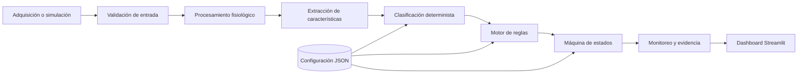
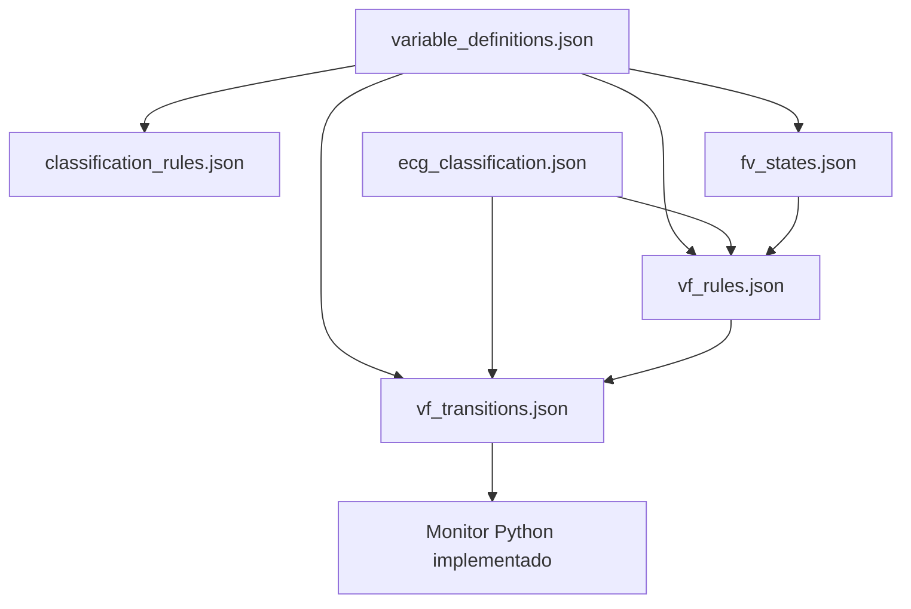
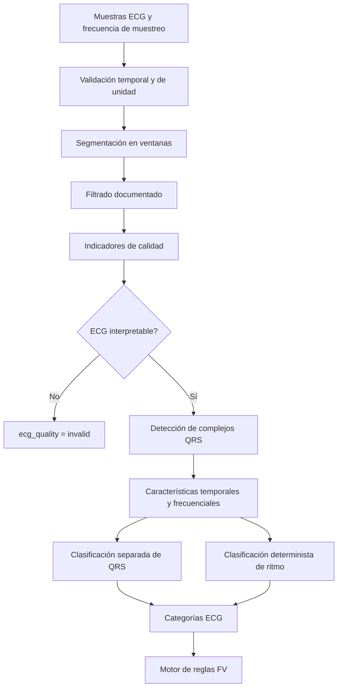
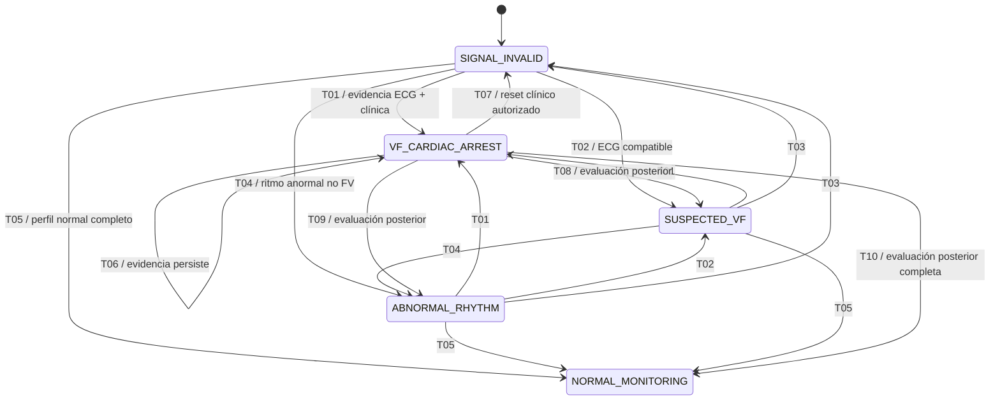
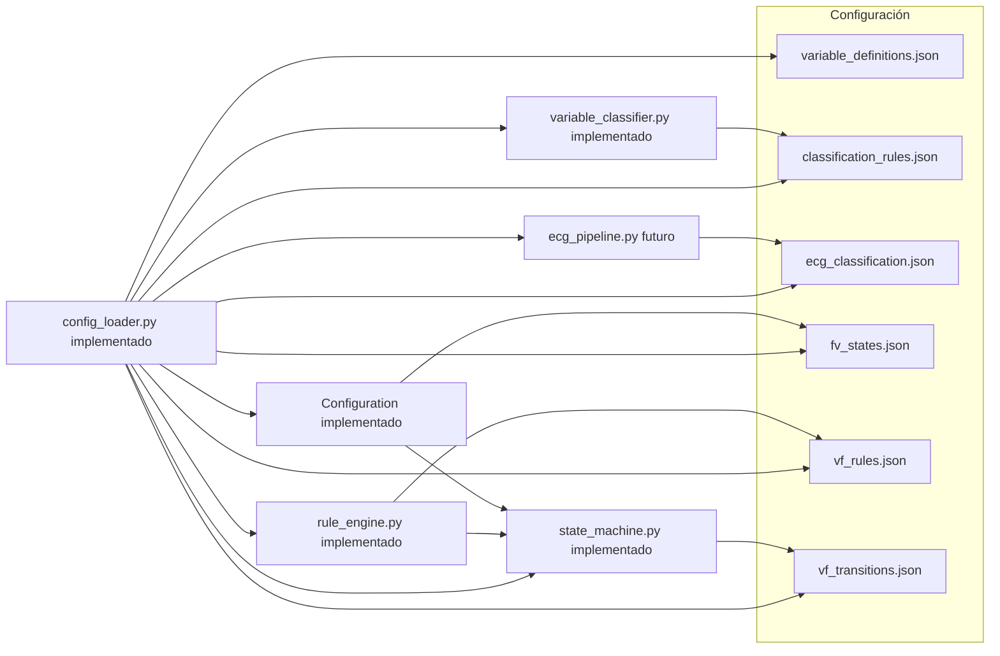

# Arquitectura del software

## Proyecto

NASA Astronaut Health Monitor / AEGIS es un prototipo experimental de monitoreo fisiológico para misiones espaciales. Esta arquitectura describe una capa híbrida: los datos se procesarán mediante módulos Python y las decisiones declarativas de clasificación y transición se mantendrán en JSON.

El sistema no es un dispositivo médico validado. Las categorías `vf_compatible`, `normal_sinus`, `abnormal_non_vf` y los estados de monitorización son resultados experimentales que requieren validación matemática, clínica y operacional antes de cualquier uso médico.

## 1. Estado de implementación

### Implementado

- `app.py` como punto de entrada mínimo.
- Autenticación local de demostración en `src/auth/service.py`.
- Interfaz Streamlit en `src/ui/`.
- Dashboard visual con lecturas vacías y ECG sintético de demostración.
- Seis archivos JSON de configuración coherentes y validados por pruebas declarativas.
- Pruebas de autenticación y de integridad de configuración.
- Motor determinista de reglas, máquina de estados finitos y coordinador de monitoreo sin dependencia de Streamlit.
- Simulador reproducible de mediciones fisiológicas y categorías ECG/clinicas sintéticas en `src/simulation/`.

### Diseñado, pero no implementado

- Adquisición real o carga de datasets fisiológicos.
- Adquisición y normalización de señales ECG en `src/processing/`.
- Procesamiento ECG y extracción de características en `src/processing/` o `src/algorithms/`.
- Procesamiento ECG y detección matemática de FV.
- Integración de los resultados con Streamlit.
- Conexión del dashboard con resultados calculados.

`src/algorithms/` todavía contiene solo su archivo de paquete. El procesamiento fisiológico está en `src/processing/` y el motor determinista está en `src/monitoring/`. El procesamiento ECG y la detección matemática de FV siguen fuera del alcance implementado.

## 2. Decisión técnica: arquitectura híbrida determinista

La arquitectura separa tres tipos de responsabilidad:

1. **Cálculo Python:** lectura, validación, filtrado, extracción de características y transformaciones numéricas.
2. **Decisión declarativa JSON:** categorías permitidas, perfiles de estado, reglas de clasificación y transiciones.
3. **Presentación Streamlit:** visualización de mediciones, señal, categorías, estado, evidencia y advertencias.

Los JSON no procesan muestras ni sustituyen la validación de tipos. Python será responsable de cargar, validar y aplicar sus estructuras. Streamlit no debe importar directamente reglas médicas para reinterpretarlas ni contener lógica matemática.

## 3. Flujo general de información

El flujo previsto es:

**Adquisición o simulación → Validación → Procesamiento → Extracción de características → Clasificación → Motor de reglas → Máquina de estados → Monitoreo → Dashboard.**



### 3.1. Responsabilidades por etapa

| Etapa | Entrada | Responsabilidad | Salida |
|---|---|---|---|
| Adquisición o simulación | Sensores, dataset o señal sintética | Obtener muestras y metadatos de origen | Muestras con tiempo, unidad y fuente |
| Validación | Muestras y metadatos | Comprobar tipos, unidades, orden temporal, faltantes y dominio | Mediciones válidas, inválidas o no evaluadas |
| Procesamiento | Mediciones y señales válidas | Limpiar, filtrar y segmentar sin cambiar el significado clínico | Señales procesadas y métricas de calidad |
| Extracción | Ventanas procesadas | Calcular características temporales, frecuenciales o morfológicas | Características numéricas con ventana y calidad |
| Clasificación | Mediciones validadas y características | Convertir resultados a categorías declaradas | Categorías atómicas |
| Motor de reglas | Categorías y reglas JSON | Comparar condiciones obligatorias y complementarias por prioridad | Estado candidato y evidencia |
| Máquina de estados | Estado anterior, candidato, transiciones y controles | Aplicar transiciones permitidas, persistencia y restricciones | Estado actual e historial |
| Monitoreo | Estado, evidencia e historial | Registrar, priorizar y exponer alertas experimentales | Evento de monitoreo explicable |
| Dashboard | Resultado de monitoreo | Presentar valores, calidad, señal, estado y advertencias | Interfaz visual |

La adquisición real y el procesamiento ECG son diseño futuro. La simulación reproducible, la validación/clasificación fisiológica, el motor de reglas, la máquina de estados y el coordinador de monitoreo ya están implementados de forma independiente de Streamlit. El dashboard todavía presenta una señal ECG sintética y valores placeholder.

## 4. Configuración JSON

Los seis archivos forman una cadena declarativa. La secuencia de interpretación propuesta es:



La relación anterior describe dependencias conceptuales. `config_loader.py` carga los seis archivos; el monitor interpreta las reglas y transiciones, mientras el procesamiento fisiológico interpreta las reglas numéricas.

### 4.1. `variable_definitions.json`

Define el vocabulario de diez variables categóricas, su descripción, unidad, fuente, tipo y `allowed_values`:

- `heart_rate_status`
- `spo2_status`
- `respiratory_rate_status`
- `blood_pressure_status`
- `ecg_quality`
- `rhythm_classification`
- `qrs_status`
- `pulse_status`
- `responsiveness_status`
- `breathing_status`

Ejemplo real:

```json
"ecg_quality": {
  "unit": "none",
  "source": "ecg_signal_processing",
  "type": "categorical",
  "allowed_values": {
    "valid": "ECG interpretable para el analisis previsto",
    "invalid": "ECG no interpretable",
    "not_assessed": "Calidad todavia no evaluada"
  }
}
```

Este archivo es el contrato de categorías. Un valor compuesto como `adequate_or_altered` no pertenece al vocabulario actual y no debe ser generado por un módulo.

`src/processing/config_loader.py` carga y valida el esquema completo. La validación numérica y la clasificación fisiológica se implementan en `src/processing/measurement_validator.py` y `src/processing/variable_classifier.py`.

### 4.2. `classification_rules.json`

Contiene reglas numéricas para clasificar cuatro mediciones:

- `heart_rate_status` en contexto adulto en reposo;
- `spo2_status` en contexto adulto de referencia;
- `respiratory_rate_status` en reposo;
- `blood_pressure_status` en reposo.

Ejemplo real:

```json
"normal_for_context": {
  "value": ">=60 AND <=100"
}
```

Las categorías de este archivo deben existir en `variable_definitions.json`. Las expresiones son datos declarativos y son interpretadas por el parser restringido de `variable_classifier.py`. La configuración no define diagnóstico ni límites clínicos adicionales.

La clasificación numérica se implementa actualmente en `src/processing/variable_classifier.py`, con un parser restringido que no ejecuta Python.

### 4.3. `ecg_classification.json`

Separa tres responsabilidades:

- `ecg_quality`: usa las características declaradas `missing_samples_ratio`, `clipping_ratio` y `noise_level`, y entrega `valid`, `invalid` o `not_assessed`.
- `qrs_status`: usa `qrs_detection_confidence` y `qrs_organization_score`, y entrega `organized`, `abnormal`, `not_organized`, `uninterpretable` o `not_assessed`.
- `rhythm_classification`: usa `vf_score`, `vf_features` y `qrs_organization_score`, y entrega `normal_sinus`, `abnormal_non_vf`, `vf_compatible`, `uninterpretable` o `not_assessed`.

El archivo declara entradas y salidas, pero no define umbrales matemáticos. `vf_compatible` es una salida futura de algoritmo y no una confirmación clínica.

**Módulo futuro propuesto:** `src/algorithms/ecg_classifier.py`, después de definir y validar los métodos matemáticos. No está implementado.

### 4.4. `fv_states.json`

Define cinco estados y un perfil de diez categorías por estado:

- `NORMAL_MONITORING`
- `ABNORMAL_RHYTHM`
- `SUSPECTED_VF`
- `VF_CARDIAC_ARREST`
- `SIGNAL_INVALID`

Los perfiles son descripciones declarativas de evidencia esperada. No deben interpretarse como mediciones faltantes ni como inferencias automáticas. Por ejemplo, `VF_CARDIAC_ARREST` incluye `pulse_status: absent`, `responsiveness_status: unresponsive` y `breathing_status: absent`, además de evidencia ECG compatible.

Los perfiles son cargados por el `Configuration` compartido; todavía no existe un módulo independiente de perfiles porque no es necesario para la primera decisión determinista.

### 4.5. `vf_rules.json`

Contiene cinco reglas con prioridad 1 a 5 y estrategia `first_matching_rule_by_priority`:

| Prioridad | Salida | Condición principal |
|---:|---|---|
| 1 | `VF_CARDIAC_ARREST` | ECG válido, ritmo `vf_compatible`, QRS `not_organized`, pulso ausente, respuesta ausente y respiración ausente o agónica |
| 2 | `SUSPECTED_VF` | ECG válido, ritmo `vf_compatible` y QRS `not_organized` |
| 3 | `SIGNAL_INVALID` | `ecg_quality: invalid` |
| 4 | `ABNORMAL_RHYTHM` | ECG válido y `abnormal_non_vf` |
| 5 | `NORMAL_MONITORING` | Perfil normal completo, incluyendo pulso, respuesta y respiración |

Las claves `required` son obligatorias; las claves `supporting` son complementarias y no son necesarias para que coincida la regla. La regla de sospecha no requiere presión arterial ni SpO₂, de modo que no retrasa la alerta por datos complementarios. La ausencia de presión arterial y una SpO₂ no fiable no equivalen a ausencia de circulación.

`src/monitoring/rule_engine.py` devuelve regla, prioridad, variables coincidentes, bloqueos, evidencia faltante, competidores y una traza de condiciones, sin afirmar un diagnóstico.

### 4.6. `vf_transitions.json`

Define la máquina de estados declarativa:

- estado inicial: `SIGNAL_INVALID`;
- evaluación periódica de cinco segundos para estados no emergentes declarados;
- evaluación inmediata cuando aparece evidencia de ritmo o pulso relevante;
- orden de prioridad: `VF_CARDIAC_ARREST`, `SUSPECTED_VF`, `SIGNAL_INVALID`, `ABNORMAL_RHYTHM`, `NORMAL_MONITORING`;
- diez transiciones `T01` a `T10`;
- control externo `authorized_clinical_operator` para salir de `VF_CARDIAC_ARREST`.

Las salidas de `VF_CARDIAC_ARREST` también requieren `post_event_circulation_assessment: completed`. La normalización del ECG no es suficiente. El archivo no implementa persistencia ni temporizadores; solo declara el intervalo periódico y el tipo de evaluación. `src/monitoring/monitor.py` aplica el intervalo con timestamps externos y `state_machine.py` conserva el historial de transiciones.

`src/monitoring/state_machine.py` aplica las transiciones declaradas, conserva historial y rechaza salidas no autorizadas.

## 5. Procesamiento fisiológico

El sistema debe distinguir cinco niveles de representación:

1. **Valor numérico adquirido:** por ejemplo, `72 bpm`, `98 %` o una presión sistólica/diastólica.
2. **Validación de medición:** comprobación de tipo, unidad, dominio, faltantes y calidad de la fuente.
3. **Característica matemática:** resultado calculado en una ventana, por ejemplo una razón de muestras faltantes o una puntuación de organización QRS.
4. **Categoría asignada:** valor atómico permitido por `variable_definitions.json`.
5. **Estado general:** uno de los cinco estados definidos en `fv_states.json`, seleccionado por `vf_rules.json` y `vf_transitions.json`.

### 5.1. Variables fisiológicas y clínicas

| Variable | Valor o característica de entrada | Categoría actual | Limitación documentada |
|---|---|---|---|
| Frecuencia cardiaca | Medición numérica en bpm | `normal_for_context`, `tachycardia`, `bradycardia`, entre otras | Las reglas numéricas actuales no son un diagnóstico |
| SpO₂ | Porcentaje de oxímetro | `adequate`, `altered`, `invalid`, etc. | Una lectura no fiable no demuestra ausencia de circulación |
| Frecuencia respiratoria | Respiraciones por minuto | `normal_for_context`, `tachypnea`, `bradypnea`, etc. | La respiración clínica adicional está separada |
| Presión arterial | Lecturas sistólica/diastólica en mmHg | `stable`, `elevated`, `low`, `altered`, etc. | La falta de lectura no equivale a ausencia de circulación |
| Calidad ECG | Características declaradas en `ecg_classification.json` | `valid`, `invalid`, `not_assessed` | No se definen umbrales en la configuración |
| QRS | Confianza y organización calculadas | `organized`, `abnormal`, `not_organized`, etc. | QRS no detectables por sí solos no demuestran FV |
| Ritmo ECG | Características ECG y puntuación futura | `normal_sinus`, `abnormal_non_vf`, `vf_compatible`, etc. | Requiere algoritmo futuro y validación |
| Pulso | Evaluación clínica o sensor validado | `present`, `absent`, `unreliable`, etc. | `absent` es evidencia clínica declarada, no una inferencia ECG |
| Respuesta | Evaluación clínica | `responsive`, `unresponsive`, `not_assessed` | No está disponible desde el dashboard actual |
| Respiración clínica | Evaluación clínica o sensor validado | `normal`, `absent`, `agonal`, etc. | No debe inferirse solo desde ECG |

La aplicación actual no adquiere ninguna de estas variables: el dashboard muestra placeholders y una señal sintética. La tabla documenta la arquitectura de datos, no una capacidad existente.

## 6. Simulación reproducible

`src/simulation/physiological_simulator.py` genera muestras sintéticas y puede ejecutar la cadena completa:

**Muestra simulada → `classify_measurements()` → categorías ECG/clínicas simuladas → `Monitor.evaluate()` → estado candidato y estado efectivo.**

Los cinco escenarios disponibles son los cinco nombres de estado actuales: `NORMAL_MONITORING`, `ABNORMAL_RHYTHM`, `SUSPECTED_VF`, `VF_CARDIAC_ARREST` y `SIGNAL_INVALID`. El escenario se conserva en metadatos y `expected_state_oracle` sirve únicamente como referencia de prueba; nunca se envía al monitor para seleccionar el estado.

La configuración de simulación permite duración, intervalo, semilla, timestamp inicial y segmentos. Las mediciones fisiológicas se generan dentro de rangos compatibles con `classification_rules.json`, excepto valores diseñados para probar invalidez en `SIGNAL_INVALID`. Las categorías `ecg_categories` y `clinical_evidence` son entradas sintéticas explícitas, no resultados de un detector ECG.

Ejemplo reproducible sin Streamlit:

```python
from datetime import datetime, timezone

from src.simulation.physiological_simulator import SimulationConfig, run_simulation

config = SimulationConfig(
    scenario="SUSPECTED_VF",
    duration_seconds=2,
    interval_seconds=1,
    seed=7,
    start_time=datetime(2026, 1, 1, tzinfo=timezone.utc),
)
results = run_simulation(config)
print(results[0].monitor_result.effective_state)
```

La simulación no genera autorizaciones clínicas automáticamente. Un control externo solo puede incluirse de forma explícita en un `ScenarioSegment` para probar una transición configurada.

La política temporal existente se conserva: el monitor usa evaluaciones periódicas de cinco segundos y eleva evidencia de sospecha o emergencia a evaluación inmediata sin `sleep()`. Por eso una secuencia `NORMAL_MONITORING → ABNORMAL_RHYTHM` se registra como transición rechazada con la configuración actual; `T04` no permite ese origen. Una secuencia permitida para probar todos los cambios es `SIGNAL_INVALID → ABNORMAL_RHYTHM → SUSPECTED_VF → VF_CARDIAC_ARREST`, respetando el intervalo periódico.

## 7. Procesamiento ECG y detección futura de FV

El diseño futuro para una señal digital debe recibir, como mínimo, muestras ordenadas, frecuencia de muestreo, unidad, identificador de fuente y marcas temporales. Esas propiedades son requisitos de diseño; no están definidas todavía como un contrato JSON ni como una clase Python.

La tubería propuesta es:



Las decisiones pendientes antes de programar incluyen:

- frecuencia de muestreo mínima y metadatos requeridos;
- longitud, solapamiento y política de cierre de ventanas;
- filtros, fase, respuesta, artefactos y distorsión aceptable;
- métricas de calidad y criterios para marcar una ventana como interpretable;
- método de detección QRS y manejo de latidos ectópicos o faltantes;
- características temporales y frecuenciales reproducibles;
- definición matemática de `vf_score` y `vf_features`;
- conjunto de referencia, etiquetas, partición de evaluación y métricas;
- comportamiento ante ruido, pérdida de señal y cambios de sensor.

No se seleccionan umbrales en esta etapa. La ausencia de QRS detectables puede deberse a ruido, desconexión, saturación u otra señal no interpretable; no demuestra por sí sola fibrilación ventricular. La salida `vf_compatible` debe permanecer separada de la confirmación clínica de paro.

## 8. Motor de reglas y máquina de estados



### 7.1. Reglas de decisión

- `VF_CARDIAC_ARREST` tiene la prioridad más alta y requiere evidencia ECG compatible, pulso ausente, respuesta ausente y respiración ausente o agónica.
- `SUSPECTED_VF` requiere únicamente ECG válido, ritmo `vf_compatible` y QRS `not_organized`; sus mediciones complementarias son opcionales.
- `SIGNAL_INVALID` representa ECG no interpretable y no elimina una emergencia que dependa de otras evidencias.
- `ABNORMAL_RHYTHM` representa un ritmo válido `abnormal_non_vf`.
- `NORMAL_MONITORING` requiere el conjunto normal completo de variables declarado en `vf_rules.json`.

El motor implementado evalúa primero las reglas por prioridad y conserva la regla coincidente como evidencia. Si no coincide ninguna regla, devuelve `no_match`; si faltan condiciones obligatorias, devuelve `indeterminate`. El monitor conserva el estado efectivo cuando no existe candidato o transición válida.

### 7.2. Persistencia e historial

La configuración actual declara un intervalo periódico de cinco segundos y evaluaciones inmediatas. El monitor acepta timestamps externos, no usa `sleep()` y omite una evaluación periódica si el intervalo no ha transcurrido. La configuración no define debounce, ventanas consecutivas, duración mínima de estado ni política de pérdida de muestras.

La configuración actual tampoco declara una transición directa de `NORMAL_MONITORING` a `ABNORMAL_RHYTHM`: `T04` solo permite ese destino desde `SIGNAL_INVALID` o `SUSPECTED_VF`. Una simulación que solicite esa secuencia debe registrar la transición rechazada y conservar el estado efectivo; el simulador no debe sobrescribir esta restricción.

El contrato futuro debería conservar, como mínimo:

- estado anterior y estado nuevo;
- instante de evaluación y ventana de datos;
- regla o transición aplicada;
- categorías y evidencia utilizada;
- condiciones faltantes o no evaluadas;
- fuente de control externo cuando exista;
- advertencias de seguridad.

### 7.3. Emergencia y salida del estado de paro

`VF_CARDIAC_ARREST` tiene una transición de retención mientras persiste la evidencia básica. Sus salidas `T07` a `T10` requieren `authorized_clinical_operator: true` y `post_event_circulation_assessment: completed`, además de la condición de destino correspondiente. La configuración declara explícitamente que la normalización ECG sola no puede inferir recuperación de circulación.

## 9. Relación entre JSON y módulos Python



Los módulos marcados como futuros corresponden al procesamiento ECG. El código actual también tiene funcionales `src/processing/` y `src/monitoring/`, siempre sin integración con Streamlit.

## 10. Separación de responsabilidades

### `src/processing/`

Responsabilidad implementada parcialmente: cargar configuración y validar/clasificar mediciones fisiológicas. Quedan pendientes normalización de señales ECG, segmentación, filtrado y cálculo de calidad. No debe decidir estados médicos ni renderizar Streamlit.

Módulos implementados: `config_loader.py`, `measurement_validator.py`, `variable_classifier.py`. Módulos futuros: `signal_validation.py`, `ecg_pipeline.py`.

### `src/algorithms/`

Responsabilidad futura: extracción de características y clasificación matemática ECG. Debe producir características y categorías declaradas, no modificar la sesión de Streamlit. La clasificación fisiológica numérica inicial está en `src/processing/variable_classifier.py`.

Módulos propuestos: `physiological_classifier.py`, `qrs_detector.py`, `ecg_classifier.py`. No implementados.

### `src/monitoring/`

Responsabilidad implementada: evaluar `vf_rules.json`, aplicar `vf_transitions.json`, conservar historial y exponer evidencia explicable. La priorización de alertas clínicas todavía no está implementada.

Módulos implementados: `rule_engine.py`, `state_machine.py`, `monitor.py`. No implementa todavía procesamiento ECG ni alarmas clínicas.

### `src/ui/`

Responsabilidad actual: configuración visual, navegación, login visual, dashboard y presentación. Debe consumir resultados ya calculados y no contener filtros, fórmulas, reglas médicas ni transiciones.

### `src/auth/`

Responsabilidad actual: autenticación local de prototipo, independiente de la lógica fisiológica. No debe cargar configuración ECG ni participar en el motor de reglas.

## 11. Contratos de datos

### 10.1. Campos definidos actualmente

Los JSON definen actualmente:

- nombres de diez variables categóricas;
- unidades, fuentes y valores permitidos en `variable_definitions.json`;
- expresiones de clasificación numérica en `classification_rules.json`;
- nombres de características ECG de entrada y salidas de clasificación en `ecg_classification.json`;
- perfiles de diez categorías para cinco estados en `fv_states.json`;
- condiciones `required` y `supporting`, prioridades y restricciones en `vf_rules.json`;
- estados, prioridades, tipos de evaluación y controles externos en `vf_transitions.json`.

### 10.2. Campos propuestos para contratos Python

Los siguientes campos son propuestas de diseño y todavía no existen en archivos ni clases Python:

| Contrato | Campos propuestos |
|---|---|
| Medición fisiológica | `name`, `value`, `unit`, `timestamp`, `source`, `quality`, `window_id` |
| Señal ECG | `samples`, `sampling_rate_hz`, `unit`, `timestamps`, `source`, `window_id`, `quality` |
| Característica | `name`, `value`, `unit`, `window_id`, `method`, `quality` |
| Categoría | `variable`, `category`, `source_feature`, `window_id`, `confidence`, `status` |
| Decisión de regla | `rule_id`, `priority`, `output_state`, `required_evidence`, `supporting_evidence`, `missing_evidence`, `warnings` |
| Transición | `from_state`, `to_state`, `transition_id`, `timestamp`, `trigger`, `authorization`, `evidence` |
| Registro de monitoreo | `current_state`, `previous_state`, `timestamp`, `window_id`, `evidence`, `history_ref`, `warnings` |

Estos contratos deben diseñarse como estructuras independientes de Streamlit. `confidence` no está definida en los JSON como criterio de decisión y no debe convertirse automáticamente en umbral clínico.

## 12. Streamlit y presentación

El flujo de UI futuro debería recibir un registro de monitoreo ya calculado y mostrar:

- valores numéricos y unidades;
- calidad de medición y señal;
- ECG y ventana temporal;
- categorías fisiológicas;
- estado actual y estado anterior;
- regla o transición utilizada;
- evidencia faltante y advertencias;
- indicación explícita de simulación y limitaciones.

La interfaz actual no calcula QRS, interpreta `vf_score`, elige prioridades ni autoriza la salida de un estado de emergencia. Estas tareas pertenecen a las capas de procesamiento, algoritmos y monitoreo.

## 13. Decisiones pendientes antes de implementar

1. Especificar el esquema formal de carga para los seis JSON.
2. Definir la representación de timestamps, zonas horarias, frecuencia de muestreo y unidades.
3. Elegir datasets y documentar licencias, etiquetas y representatividad.
4. Seleccionar filtros y métodos QRS con validación reproducible.
5. Definir características temporales y frecuenciales sin inventar umbrales.
6. Definir cómo se obtendrán pulso, respuesta y respiración clínica de forma independiente del ECG.
7. Definir persistencia, ventanas consecutivas, debounce y recuperación controlada.
8. Determinar cómo se manejarán datos faltantes, conflictos entre sensores y cambios de calidad.
9. Establecer métricas de evaluación y casos adversariales.
10. Revisar el comportamiento de recarga de Streamlit antes de una demostración estable.

## 14. Ejecución actual

Desde la raíz del repositorio:

```bash
python -m streamlit run app.py
```

Pruebas:

```bash
python -m pytest -q
```

La aplicación actual muestra login, identidad y dashboard visual. Los módulos de procesamiento y monitoreo pueden ejecutarse de forma independiente, pero todavía no están conectados al dashboard.

## 15. Alcance y seguridad

Este proyecto es un prototipo experimental de simulación. No constituye un dispositivo médico validado, no confirma fibrilación ventricular ni paro cardiaco y no reemplaza protocolos clínicos, personal sanitario o sistemas certificados. Toda alerta futura deberá presentarse como resultado experimental con evidencia, limitaciones y fuente de datos.
